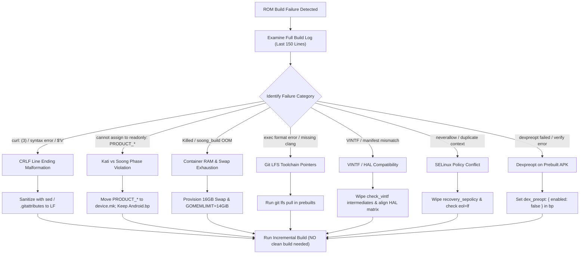

# Android Custom ROM Development & Build Troubleshooting Guide

This skill equips the Antigravity agent with production-grade engineering knowledge, failure diagnoses, and automated repair procedures for building Android custom ROMs (Android 14, 15, 16, 17+).

---

## 🧭 Core Workflow & Decision Flowchart



---

## ⚡ The 10 Golden Rules of Custom ROM Engineering

### 1. The Kati vs. Soong Separation (Never put `PRODUCT_*` in `Android.mk`)
* **Phase 1 (Product Configuration)**: Reads `device.mk`, `BoardConfig.mk`, `AndroidProducts.mk`. In this phase, `PRODUCT_PACKAGES`, `PRODUCT_COPY_FILES`, and `PRODUCT_PROPERTY_OVERRIDES` are mutable.
* **Phase 2 (Soong)**: Reads all `Android.bp` files across the tree and generates `out/soong/build.<product>.ninja`. Prebuilt apps (`android_app_import`), binaries, and libraries belong here.
* **Phase 3 (Kati / Make)**: Kati locks all `PRODUCT_*` variables as **read-only**. It scans all subdirectories and executes every file named `Android.mk`.
* **The Rule**: `Android.mk` is a **reserved file name** for module build rules (`LOCAL_*` variables and `include $(BUILD_*)`). **NEVER** assign `PRODUCT_PACKAGES` inside an `Android.mk`. It will immediately cause:
  ```text
  error: cannot assign to readonly variable: PRODUCT_PACKAGES
  ```
* **Solution**: Product package declarations belong in `.mk` fragments (e.g., `device_<device>_<app>.mk`) inherited from `device.mk`:
  ```makefile
  $(call inherit-product-if-exists, vendor/<name>/aosp/device_<device>.mk)
  ```
  And the app module is declared in `Android.bp`.

---

### 2. Line Ending Normalization (`\r\n` vs `\n`)
* Scripts, configuration files (`.env`), XMLs, and policy files created or edited on Windows contain Carriage Return characters (`\r\n`).
* **Symptoms**:
  - `curl: (3) URL rejected: Bad query`: caused by sourcing a `.env` file where `URL="https://...download\r"`.
  - `/bin/sh: $'\r': command not found`
  - Sepolicy compile failures: hidden carriage returns break parser lexing.
* **Solution**:
  - Add `.gitattributes` to every repository:
    ```gitattributes
    * text=auto eol=lf
    *.sh text eol=lf
    *.env text eol=lf
    *.mk text eol=lf
    *.bp text eol=lf
    *.xml text eol=lf
    *.rc text eol=lf
    ```
  - Defensively sanitize inputs in shell scripts:
    ```bash
    sed -i 's/\r$//' path/to/*.sh path/to/*.env 2>/dev/null || true
    ```
  - Strip trailing `\r` when reading bash variables:
    ```bash
    VAR="${VAR%$'\r'}"
    ```

---

### 3. Dexpreopt for Prebuilt Applications
* When importing prebuilt apps (such as Google Camera, GCam mods, Dolby Atmos, or microG) via `android_app_import` in `Android.bp`, AOSP attempts to strip the DEX and pre-optimize it for the target architecture (`dex2oat`).
* Prebuilt commercial APKs often fail dexpreopt due to multidex structures or hidden API dependencies.
* **Solution**: Always explicitly disable dexpreopt in the `Android.bp`:
  ```blueprint
  android_app_import {
      name: "GoogleCameraEng",
      apk: "GoogleCameraEng.apk",
      product_specific: true,
      privileged: true,
      presigned: true,
      dex_preopt: {
          enabled: false,
      },
  }
  ```

---

### 4. Container Swap & Memory Tuning (Preventing OOM Kills)
* In cloud/container build environments (e.g., Docker, Crave.io, GitHub Actions), memory limits often trigger the Linux Out-Of-Memory (OOM) killer on `soong_build` or `clang++`.
* **Solution**: Check available swap and provision a 16GB swap file before starting the build:
  ```bash
  TOTAL_SWAP_MB=$(free -m 2>/dev/null | awk '/^Swap:/ {print $2}')
  if [ -n "$TOTAL_SWAP_MB" ] && [ "$TOTAL_SWAP_MB" -lt 8192 ]; then
      sudo fallocate -l 16G /swapfile 2>/dev/null || sudo dd if=/dev/zero of=/swapfile bs=1M count=16384 2>/dev/null || true
      sudo chmod 600 /swapfile 2>/dev/null || true
      sudo mkswap /swapfile 2>/dev/null || true
      sudo swapon /swapfile 2>/dev/null || true
  fi
  ```
* Tune Go GC and Soong memory settings:
  ```bash
  export GOGC=40
  export GOMEMLIMIT=14GiB
  export MALLOC_ARENA_MAX=2
  export SOONG_GOGC=40
  export SOONG_INCREMENTAL_ANALYSIS=false
  ```

---

### 5. Incremental vs. Clean Build Decisions
* **Do NOT run `make clean`** for:
  - Makefile syntax errors or Kati errors (`cannot assign to readonly variable`).
  - `Android.bp` modifications or module additions.
  - Shell script / prebuilt fetch failures.
  - Minor C/C++/Java/Kotlin bug fixes.
  - *Kati and Soong automatically monitor modified files and regenerate Ninja build targets incrementally.*
* **Targeted Partial Cleans**:
  - Kernel changes: `rm -rf out/target/product/<device>/obj/KERNEL_OBJ`
  - VINTF manifest changes: `rm -rf out/target/product/<device>/obj/PACKAGING/check_vintf_all_intermediates`
  - SELinux policy changes: `rm -rf out/soong/.intermediates/system/sepolicy/recovery_sepolicy.*`
* **When is a full clean (`rm -rf out`) actually required?**:
  - Major Android version upgrade (e.g., A16 to A17).
  - Switching build variant (user to userdebug or eng) with incompatible signers.
  - Fundamental changes in partition layout / dynamic partition sizing.

---

### 6. Git LFS Toolchains
* AOSP prebuilts (Clang compiler under `prebuilts/clang/host/linux-x86` and Rust compiler under `prebuilts/rust`) frequently use Git LFS pointers.
* If Git LFS is missing or not pulled, binaries will be ~130-byte text pointers, throwing:
  `exec format error: prebuilts/clang/host/linux-x86/.../clang`
* **Solution**:
  ```bash
  git -C prebuilts/clang/host/linux-x86 lfs pull
  git -C prebuilts/rust lfs pull
  ```

---

### 7. VINTF Compatibility & Manifests
* Android enforces runtime hardware interface matching between `/vendor/etc/vintf/manifest.xml` and `/system/etc/vintf/compatibility_matrix.xml`.
* If a HAL declaration version is bumped in the vendor tree without corresponding matrix support, `check_vintf` will fail.
* Always verify target HAL interface version (HIDL vs AIDL) and remove intermediate check files when updating manifests.

---

### 8. System Priv-App Permissions & Whitelisting
* Any app installed to `/product/priv-app` or `/system/priv-app` requesting privileged permissions (e.g., `PACKAGE_USAGE_STATS`, `WRITE_SECURE_SETTINGS`) **must** provide a permissions XML whitelist:
  ```xml
  <permissions>
      <privapp-permissions package="com.package.name">
          <permission name="android.permission.PACKAGE_USAGE_STATS"/>
      </privapp-permissions>
  </permissions>
  ```
* Include it in `Android.bp`:
  ```blueprint
  prebuilt_etc {
      name: "privapp-permissions-myapp",
      src: "privapp-permissions-myapp.xml",
      sub_dir: "permissions",
      product_specific: true,
  }
  ```

---

### 9. SystemUI Quick Settings Tile State Sync
* For audio mods and hardware services (e.g., Dolby Atmos):
  - Do not rely on polling.
  - Use `TileService.requestListeningState(context, ComponentName(...))` when internal settings change.
  - Use `OnSharedPreferenceChangeListener` or reactive Kotlin `StateFlow` to synchronize UI in real-time.
  - In companion objects for AudioEffects, avoid `@hide` fields (e.g. `EFFECT_TYPE_NULL`) that cause `NoSuchFieldError` on non-framework classloaders.

---

### 10. Multi-Repo Branch Parity
* Custom ROM source trees often comprise multiple coupled repositories:
  - `device/xiaomi/<device>`
  - `device/xiaomi/<soc>-common`
  - `vendor/xiaomi/<device>`
  - `vendor/xiaomi/<soc>-common`
  - `kernel/xiaomi/<soc>`
  - `hardware/dolby`
  - `vendor/GCam_<device>`
* Always maintain unified branch naming (e.g. `PixelOS-17-base` and `PixelOS-16-QPR2`) and keep them fast-forward synchronized across all remotes.

---

## 🛠️ Included Reference Guides

For in-depth explanations and checklists, consult:
* [Build Failure Playbook](./references/build_failure_playbook.md) — Comprehensive failure catalog and solutions.
* [Kati & Soong Rules](./references/kati_soong_rules.md) — Architecture rules for blueprints and makefiles.
* [Incremental vs. Clean Guide](./references/incremental_vs_clean.md) — Fast build decision tree.

