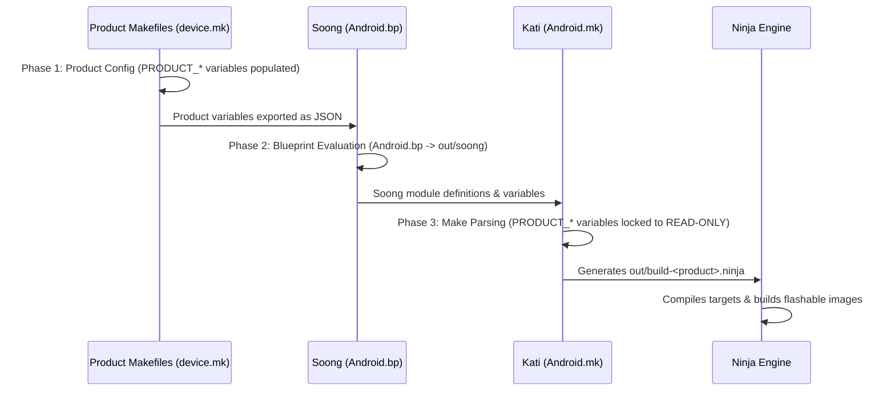

# Kati, Soong, & Make Architecture Rules for Modern AOSP

This document explains the division of responsibilities in modern AOSP build systems (Android 10 through Android 17+).

---

## 🏗️ The Three Build Phases



---

## 📌 Variable Rules: Where Variables Can and Cannot Be Modified

| Variable Type | Allowed in `device.mk` / `BoardConfig.mk` | Allowed in `Android.bp` | Allowed in `Android.mk` |
| :--- | :---: | :---: | :---: |
| `PRODUCT_PACKAGES` | ✅ Yes (Phase 1) | ❌ No | ❌ **FORBIDDEN** (ReadOnly in Kati) |
| `PRODUCT_COPY_FILES` | ✅ Yes (Phase 1) | ❌ No | ❌ **FORBIDDEN** (ReadOnly in Kati) |
| `PRODUCT_PROPERTY_OVERRIDES` | ✅ Yes (Phase 1) | ❌ No | ❌ **FORBIDDEN** (ReadOnly in Kati) |
| `PRODUCT_SOONG_NAMESPACES` | ✅ Yes (Phase 1) | ❌ No | ❌ **FORBIDDEN** (ReadOnly in Kati) |
| `LOCAL_MODULE` / `LOCAL_*` | ❌ No | ❌ No | ✅ Yes (Phase 3) |
| `android_app_import` / `etc` | ❌ No | ✅ Yes (Phase 2) | ❌ No |

---

## 📦 Defining Prebuilt System / Product Apps in `Android.bp`

When importing prebuilt APKs into modern AOSP, use `Android.bp`:

```blueprint
android_app_import {
    name: "MyCustomApp",
    apk: "app_binary.apk",

    // Partition placement
    product_specific: true, // or system_ext_specific: true, vendor: true

    // Platform privilege & signing
    privileged: true,
    presigned: true, // Preserves the vendor/upstream APK signature

    // Disable dexpreopt to avoid dex2oat bootclasspath mismatch
    dex_preopt: {
        enabled: false,
    },

    // Dependencies installed automatically alongside the app
    required: [
        "privapp-permissions-mycustomapp",
        "mycustomapp_config",
    ],
}

prebuilt_etc {
    name: "privapp-permissions-mycustomapp",
    src: "privapp-permissions-mycustomapp.xml",
    sub_dir: "permissions",
    product_specific: true,
}

prebuilt_etc {
    name: "mycustomapp_config",
    src: "config.xml",
    sub_dir: "app_config",
    product_specific: true,
}
```

---

## ⚙️ Inheriting Packages in Device Trees

Inside your device's `device.mk`:

```makefile
# Include the vendor/package product makefile fragment
$(call inherit-product-if-exists, vendor/myvendor/apps/device_mycustomapp.mk)
```

Inside `vendor/myvendor/apps/device_mycustomapp.mk`:

```makefile
# Add the Soong-defined module to the product package list
PRODUCT_PACKAGES += \
    MyCustomApp
```

> [!IMPORTANT]
> The product fragment must have an extension like `.mk` (e.g. `device_mycustomapp.mk` or `packages.mk`).
> **NEVER name this fragment `Android.mk`**. If named `Android.mk`, Kati will automatically parse it during Phase 3 when `PRODUCT_PACKAGES` is immutable.

