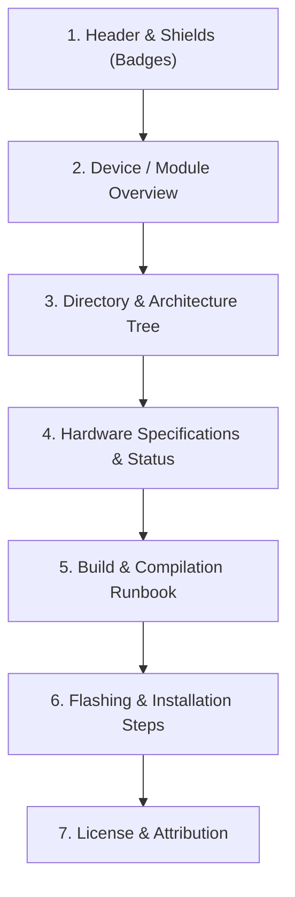

# Android ROM Technical Documentation Standards

This skill provides templates, structural rules, and design standards for creating clean, professional, open-source documentation for Android custom ROMs, device trees, and audio/camera modules.

---

## 📐 Document Structure Standard

Every ROM or device tree `README.md` must follow this 7-section hierarchy:



---

## 🏷️ 1. Shields & Badges Standard
Include clean, SVG-based Shields.io badges at the top:
```markdown
[](https://android.com)
[](LICENSE)
[-orange.svg)](https://github.com/rony1duet)
[]()
```

---

## 🌲 2. Architectural ASCII Directory Tree
Include an explicit directory tree documenting files and their purposes:
```text
vendor/GCam_sweet2/
├── Android.bp                                 # Soong blueprint for GoogleCameraEng module
├── README.md                                  # Repository documentation
├── common/
│   └── GCam_Config_sweet2.xml                 # Hardware-tuned camera configuration
├── aosp/
│   ├── device_sweet2_gcam.mk                  # Device makefile fragment
│   └── local_manifests/
│       └── gcam_sweet2.xml                    # Local repo manifest entry
└── system/product/app/GoogleCameraEng/        # Prebuilt installation target
```

---

## 📊 3. Hardware Support Checklist
Display a Markdown table showing verified hardware subsystems:

| Component | Status | Notes |
| :--- | :---: | :--- |
| **Boot & Display** | 🟢 Working | 120Hz refresh rate, AMOLED HDR10 |
| **Audio & Dolby** | 🟢 Working | Dolby Atmos DSP with real-time QS sync |
| **Camera & GCam** | 🟢 Working | MGC 9.6.080 4K@30fps, 108MP, Aux lenses |
| **Wi-Fi & Bluetooth** | 🟢 Working | Dual-band 2.4/5GHz, LDAC, aptX |
| **RIL & VoLTE** | 🟢 Working | Dual SIM 4G, VoLTE, VoWiFi |
| **Biometrics** | 🟢 Working | Side fingerprint & Face unlock |
| **SELinux** | 🟢 Enforcing | Full SELinux Enforcing rules |

---

## 🛠️ Included Reference Templates

Load these templates on demand to save tokens:
* [Device Tree README Template](./references/device_tree_readme_template.md) — For `device/xiaomi/<device>`.
* [System App & Module README Template](./references/module_readme_template.md) — For apps and Magisk/KSU modules.
* [ROM Release Changelog Template](./references/changelog_template.md) — For GitHub releases and update feeds.

