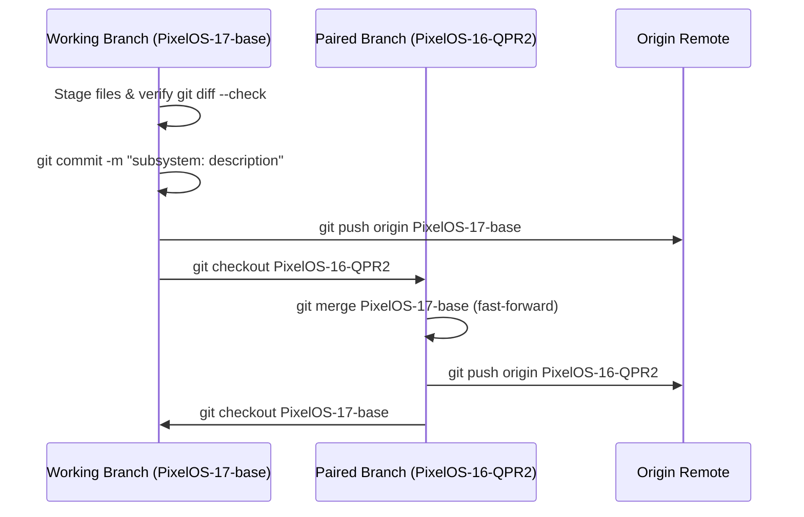

# Android ROM Git Commit & Branch Synchronization Standards

This runbook guides agents in drafting production-grade commit messages, performing strict pre-commit cleanup, and keeping multi-branch ROM trees in sync.

---

## 🛑 1. Pre-Commit Staging Hygiene (Forbidden Files)

**NEVER** stage or commit temporary, local, or build-generated files:
- **Build & IDE caches**: `.gradle/`, `.idea/`, `.kotlin/`, `build/`, `out/`, `bin/`, `.cxx/`
- **Local configs**: `local.properties`, `gradle.properties`, `settings.gradle` (in pure AOSP packages)
- **Test artifacts**: `AndroidManifest_debug.xml`, test packages (`*.apk`, `*.aab`), temporary screenshots (`*.png`)
- **Binary objects**: `.so` libraries unless officially pinned and tracked in a prebuilt vendor tree.

### Quick Sanitize Command
Before `git add`, purge local build garbage:
```bash
rm -rf .gradle .idea .kotlin build out 2>/dev/null || true
rm -f AndroidManifest_debug.xml local.properties *.png 2>/dev/null || true
```

Or run the automated helper:
[git_precommit_check.sh](./scripts/git_precommit_check.sh)

---

## 📝 2. Commit Message Conventions

Follow the AOSP / LineageOS / PixelOS subsystem prefix convention:

```text
<subsystem>: <imperative summary>

[optional body explaining why the change was necessary]
```

### Subsystem Tags
- **Apps / Audio**: `LunarisDolby:`, `Aperture:`, `AudioFX:`, `Settings:`
- **Device Trees**: `<device>:`, `sweet2:`, `sm6150-common:`
- **Vendor / Prebuilts**: `gcam:`, `vendor:`, `prebuilts:`
- **Kernel / HALs**: `kernel:`, `sepolicy:`, `hardware:`
- **Build Infra**: `build_scripts:`, `manifest:`, `soong:`

### Rules
1. **Imperative Mood**: Use "fix", "add", "synchronize", "remove", "update" (NOT "fixed", "adds", "fixing").
2. **Concise Summary**: Under 72 characters on the first line.
3. **No Redundant Contributors**: Keep commit logs focused on technical changes rather than marketing fluff.

For examples, see [Commit Style Guide](./references/commit_style_guide.md).

---

## 🔄 3. Multi-Branch Parity Protocol

When working in ROM trees with paired base branches (e.g., `PixelOS-17-base` and `PixelOS-16-QPR2`):



### Standard Execution Steps
```bash
# 1. Commit on active branch
git add <files>
git diff --cached --check # verify NO trailing whitespace / CRLF
git commit -m "<subsystem>: <imperative message>"
git push origin PixelOS-17-base

# 2. Sync to paired branch
git checkout PixelOS-16-QPR2
git merge PixelOS-17-base
git push origin PixelOS-16-QPR2

# 3. Return to primary branch
git checkout PixelOS-17-base
```

Or run the automated synchronizer:
[sync_rom_branches.sh](./scripts/sync_rom_branches.sh)

---

## ⚡ Token-Saving Guidelines for Agents
- Do not run verbose `git diff` on entire repositories if checking file lists suffices (`git status --short`, `git diff --stat`).
- Use `git diff --check` instead of printing entire files to check whitespace.
- Run `git_precommit_check.sh` to validate staging in a single command.

